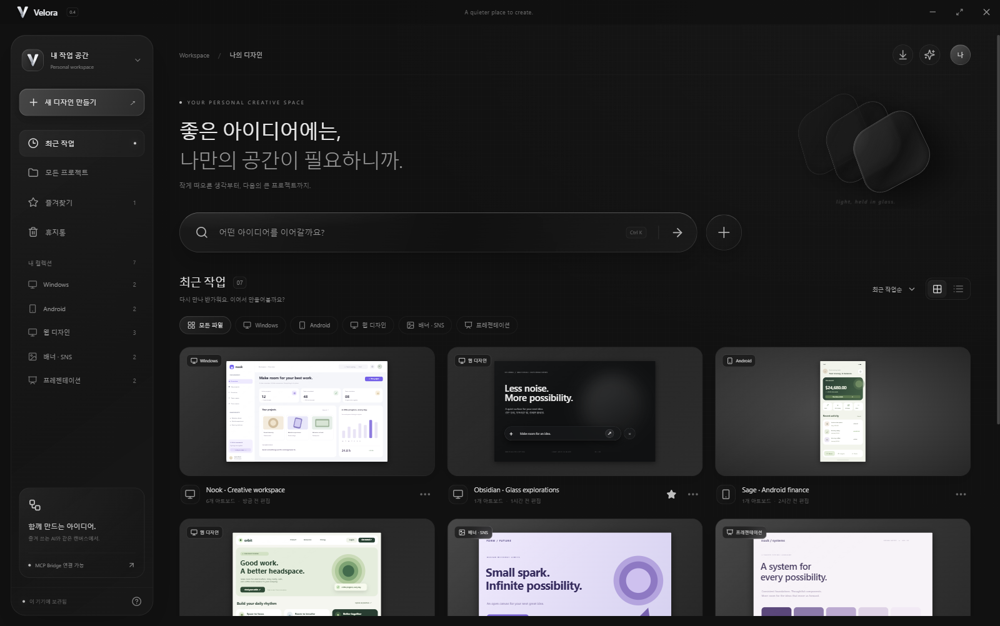
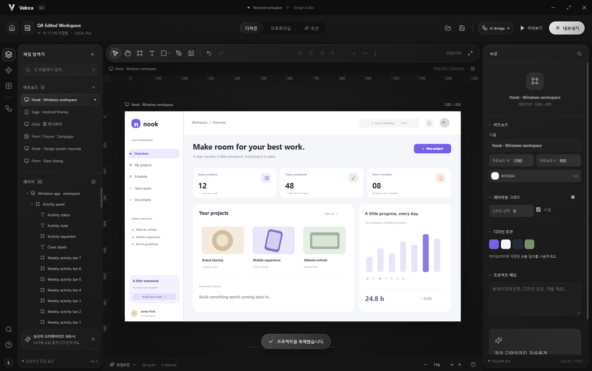

<p align="center"></p>

<p align="center"><strong>Visual design, in flow.</strong><br>검은 유리 위에서, 다음 아이디어를 디자인하세요.</p>

<p align="center"><a href="https://github.com/se01hxa/Velora/releases/latest">Windows 다운로드</a> · <a href="README.ko.md">사용 및 빌드 가이드</a> · <a href="docs/MCP.ko.md">MCP 연결</a></p>

Velora는 Windows용 로컬 디자인 도구입니다. 프로젝트 홈에서 작업을 고르고, 중첩 레이어·자동 레이아웃·컴포넌트·프로토타입·키프레임으로 Windows, Android, 웹, 배너와 프레젠테이션을 디자인합니다. HTML/CSS, React, Android XML·Compose, Windows WPF 코드와 SVG·PNG·PPTX로 내보낼 수 있습니다.



## Windows 설치

[최신 릴리스](https://github.com/se01hxa/Velora/releases/latest)에서 **Velora-Setup-0.4.0.exe**를 다운로드해 실행합니다. 설치를 마치면 바탕화면과 시작 메뉴의 **Velora**로 엽니다. 설치 파일은 Windows x64용이며 상용 코드 서명은 포함하지 않습니다.

- `Velora-Setup-0.4.0.exe`: Windows 설치 파일
- `Velora-source.zip`: 전체 소스와 테스트, 빌드 안내
- `Velora-Brand.zip`: 직접 제작한 V 로고의 SVG·PNG·Windows ICO
- `SHA256SUMS.txt`: 배포 파일 확인용 해시

## 작업 공간과 편집

프로젝트 카드, 검색, 플랫폼 필터, 그리드·목록 보기, 즐겨찾기, 이름 변경, 복제와 휴지통 복원을 제공합니다. 프로젝트는 이 PC에 따로 자동 보관하며 `.luma.json` 파일로 저장하고 옮길 수 있습니다.

편집기에서는 중첩 프레임, 자동 레이아웃, 컴포넌트와 인스턴스, 텍스트·도형·이미지·자유 그리기, 그라디언트·블러·유리·그림자, 정렬·제약·변환, 화면 연결과 타임라인을 사용할 수 있습니다.



## AI / MCP

**AI Bridge**에서 GPT Codex, Antigravity, Claude Desktop, Claude Code용 설정을 복사합니다. 별도 Node.js 설치 없이 Velora에 포함된 런타임이 MCP 서버를 실행합니다. 앱을 열어 둔 상태에서 현재 문서 조회, 아트보드 생성, 배치 편집, 선택, 취소·다시 실행, 코드 생성과 PNG 렌더링을 사용할 수 있습니다.

이전 Luma Studio 프로젝트와 연결을 이어 쓰도록 저장소 이름, `.luma.json`, `luma_*` 도구, `luma://document`, `LUMA_*` 환경변수와 기존 MCP 설정 항목을 호환 목적으로 유지합니다. 이름을 바꾼 뒤에는 **AI Bridge**에서 새 실행 경로를 복사합니다. 클라이언트 계정과 구독은 각 제품에서 설정합니다.

연결과 읽기 전용은 앱에서 제어하며 AI 변경도 실행 취소할 수 있습니다. [연결 가이드](docs/MCP.ko.md)와 [편집 예제](docs/MCP-operations.ko.md)를 참고하세요.

## 소스에서 실행 및 빌드

Windows와 Node.js 22.12 이상을 사용합니다.

```powershell
npm ci --no-audit --no-fund
node node_modules/electron/install.js
npm run build
npm start
```

설치 파일을 만들려면 `build-windows.cmd` 또는 `npm run dist`를 사용합니다. 결과는 프로젝트 옆 `release` 폴더에 생성됩니다.

```powershell
npm test
node --test mcp/check-integration.cjs
```

## 로고

Velora의 V는 두 겹의 은색 리본이 만나는 모양으로 직접 그린 벡터입니다. 로고 원본은 `src/assets/velora-mark.svg`, 앱 아이콘은 `build/icon.svg`와 `build/icon.ico`에 있습니다. 작게 표시되는 Windows 아이콘을 위해 16–256px 프레임을 포함합니다.

## 지원 범위

Velora는 단일 사용자용 로컬 편집기입니다. Figma 전체 기능과 `.fig` 호환, 실시간 공동 편집, 정밀 베지어 핸들, 모든 언어 변환은 지원하지 않습니다. 유리는 블러·투명도·그라디언트 기반이며, 네이티브 형식과 PPTX에서는 일부 효과·모션·상호작용을 근사하거나 생략합니다. 내보낸 코드에 비즈니스 로직과 서버 연결은 포함하지 않습니다. 대상 환경에서의 통합과 검토가 필요합니다.

서드파티 소프트웨어의 라이선스는 [THIRD-PARTY-NOTICES.txt](THIRD-PARTY-NOTICES.txt)에 정리했습니다.
